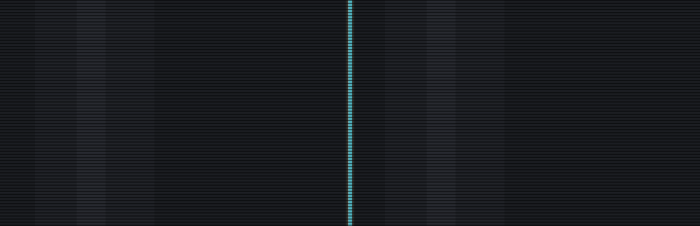

# DXO-ONE-XLAB

<p align="center">
  
</p>

**给 DxO ONE 多一些拍摄玩法。** 在相机里切换滤镜，在电脑上导入自己的风格、预览效果并管理卡内清单。

这里持续维护相机端补丁、桌面 App 和滤镜工具，也会继续探索更多实用功能。项目仍在迭代，支持范围与验证结果以各入口说明为准。

## 先找到你的入口

| 你想做什么 | 从这里开始 |
| --- | --- |
| 给 L口 / L口改C口相机安装滤镜补丁 | [Lightning 完整包与安装说明](Lightning-L口/README.md) |
| 给原生 C口相机安装触屏补丁 | [USB-C 触屏包与安装说明](USB-C-C口/README.md)，目前没有滤镜功能 |
| 用电脑导入、预览和管理滤镜 | [桌面 App](#桌面-app) |
| 用 Python 转换或替换自己的滤镜 | [自定义滤镜工具与流程](自定义置入滤镜流程/README.md) |
| 安装 Mac / Windows 桌面版 | [安装包与使用说明](#安装包与使用说明) |
| 从源码构建 Mac / Windows 安装包 | [桌面构建说明](Rust重构/dxo-lut-tool/README.md#构建安装包) |

## 支持哪些相机

**以机身固件判断，不能只看接口外形。** L口换装 C口后，如果仍是 Lightning 固件，就走 L口流程。

| 机型 / 固件 | 相机端可用内容 | 桌面 App 补丁入口 |
| --- | --- | --- |
| L口，或 L口改C口；`3.2.0 / ecef5ef809` | **Build 72 滤镜完整包**，含触屏运行时依赖 | 可进入 Lightning 完整版安装流程 |
| 原生 C口；`3.2.0 / 267b1a9e02` | 林达 v26 **触屏补丁**，无滤镜功能 | 显示“开发测试中，敬请期待” |
| 其他或未确认固件 | 尚未适配 | 先确认固件，不安装 |

两套补丁互不兼容，不能混装。仓库附带的原生 C口触屏包与 App 中尚未开放的 C口补丁流程是两个独立入口。

## 相机滤镜 · Build 72

在相机菜单第六页，上下切换 **11 个档位（含 NONE）**，左右翻页；成功切档后记住当前选择，下次开机自动恢复。

| 菜单名 | 滤镜文件 | 风格说明 |
| --- | --- | --- |
| NONE | `lut_orig.bin` | 透传档，保留源影调 |
| VELVIA | `lut_vel.bin` | VELVIA 风格 |
| G200 | `lut_gold.bin` | GOLD200 风格，预装默认档 |
| PORTRA | `lut_port.bin` | PORTRA 风格 |
| HP5 | `lut_hp5.bin` | 黑白风格 |
| R-POSI | `lut_posi.bin` | Ricoh Positive Film 风格 |
| R-HIBW | `lut_hibw.bin` | Ricoh 高反差黑白风格 |
| FUYUNO | `lut_fuyu.bin` | 冬野 |
| KYUSHU | `lut_kyus.bin` | 九秋 |
| SATOBI | `lut_sato.bin` | SATOBI 风格 |
| INSTA | `lut_insta.bin` | Dehancer Instax+2383 风格 |

发布包使用原厂基础影调与滤镜复合的配方。风格名称用于描述来源，不代表经过仪器校准或与胶片实物完全一致；来源与权利说明见 [THIRD_PARTY.md](THIRD_PARTY.md)。

Build 72 于 2026-11-17 记录相机实机用例 0–7 通过，包括十一档切换、滤镜记忆和拍摄回归。已知预览切档偏慢；完整历史、撤回版本及技术细节见 [版本与维护记录](Lightning-L口/版本与维护记录.md)。

### 安装与升级

1. **确认上表的机型与固件**，阅读 [运行时依赖说明](DEPENDENCIES.md)，把照片和现有补丁备份到电脑。
2. 校验下载的 Lightning 完整包：

   ```bash
   cd Lightning-L口
   shasum -a 256 -c SHA256SUMS.txt
   ```

   19 件应全部通过；Windows 可用 SHA-256 校验工具核对同一清单。
3. 按 [Lightning 安装说明](Lightning-L口/README.md) 将完整包内容复制到卡根目录，与 `DCIM/` 同级。**卡上已有 `touch_prefs.bin` 时保留原件**；`dxot/` 保持整目录，`PH_DIAG/` 必须存在。
4. 逐文件回读校验；保留的个人 `touch_prefs.bin` 不要求匹配仓库默认文件。正常弹出卡，装回相机开机，**等约 3 秒**再触屏。

从旧版本升级也使用完整包，不只替换 `ph_menu.bin`。`ph_last.bin` 是相机自动创建的滤镜记忆文件，无需手工部署；缺失或损坏时回退到 G200。

已有桌面 App 的用户，可在“更新补丁”中选择“L口 / L口改C口”，核对目标卡与安装计划后确认安装。App 安装流程的真实硬件验收仍待完成，见下方验证范围。

### 暂时停用

关机取卡，将卡根的 `autoexec.ash` 改名为 `autoexec.ash.disabled`，即可停止开机加载；改回原名恢复。补丁在开机时载入运行内存，不刷写固件。**保留 `DCIM/` 与 `touch_prefs.bin`**；完整清理方法见对应补丁包说明。

## 桌面 App

当前版本 **0.1.0**，使用 Tauri 2 + Rust。提供滤镜导入、本地库、图片对比预览、卡内清单与相机名称设置，以及 Lightning 完整补丁安装流程。

- 导入 `.cube`、`.3dl`、`.csp`、`.xmp`（近似转换）和 Hald 图像，调整参数后保存到本地库。
- XMP 面向 Lightroom / Camera Raw 普通调色预设：近似转换全局明暗、饱和度、HSL 和点曲线；不等同于 Adobe 原效果。未转换参数见导入日志，完整范围见[桌面说明](Rust重构/dxo-lut-tool/README.md#xmp-预设导入)。
- 预览与写卡共用 CC 表；加入卡清单后设置“相机名称”，确认写卡后才在相机生效。
- 写卡与补丁安装包含只读预检、目标确认、本地备份和回读校验。

### 安装包与使用说明

**当前提供 0.1.0 测试安装包，尚未正式签名分发。** 请到 [GitHub Releases 下载](https://github.com/Lohaslee/dxo-one-xlab/releases/tag/v0.1.0)，也可直接点击下表。两包来自同一提交 `13b8c82`，[CI 构建记录](https://github.com/Lohaslee/dxo-one-xlab/actions/runs/44521929054)可供核对。安装包不随 Git 源码克隆，可按[构建说明](Rust重构/dxo-lut-tool/README.md#构建安装包)重新生成。

| 平台 | 安装包下载 | 安装方式与限制 |
| --- | --- | --- |
| macOS Apple Silicon | [下载 DMG](https://github.com/Lohaslee/dxo-one-xlab/releases/download/v0.1.0/DXO-ONE-XLAB-0.1.0-macOS-arm64.dmg) | 打开 DMG，拖入 Applications。最低版本声明为 macOS 11.0，目前仅在 macOS 26.1 arm64 实测；不支持 Intel Mac。ad-hoc 签名、未公证，下载后可能被 Gatekeeper 拦截 |
| Windows x64 | [下载 Setup.exe](https://github.com/Lohaslee/dxo-one-xlab/releases/download/v0.1.0/DXO-ONE-XLAB-0.1.0-Windows-x64-Setup.exe) | 运行安装器，按当前用户安装。已在 Windows 11 x64 CI 验证；Windows 10 尚未实测。未签名，可能出现 SmartScreen 提示；缺少 WebView2 时首次安装需要联网 |

同时下载 [SHA256SUMS.txt](https://github.com/Lohaslee/dxo-one-xlab/releases/download/v0.1.0/SHA256SUMS.txt) 核对所选文件；具体校验方法、系统提示处理、升级与数据目录见[桌面安装说明](Rust重构/dxo-lut-tool/README.md#安装与升级)。

2026-11-19 验证：两端构建及回归通过（每端 23 项 UI 测试；macOS 152 项 Rust 测试通过、4 项忽略）；Mac 安装启动及同包覆盖后的数据文件校验通过，Windows 静默安装、启动、同包覆盖、卸载及中文/空格安装路径验证通过。**尚未验证旧版到新版的数据迁移、缺少 WebView2 的干净 Windows 首装、Windows 交互体验，以及两端 App 真卡写入与相机实拍色彩一致性。**

### 从源码运行

安装 Xcode Command Line Tools、Rust/rustup、Python 3 和 Node.js 22 后：

```bash
git clone https://github.com/Lohaslee/dxo-one-xlab.git
cd dxo-one-xlab/Rust重构/dxo-lut-tool
bash dist/verify-source.sh
open dxo-app/AppBundle/DXO-ONE-XLAB.app
```

首次构建需要联网获取工具链与依赖；生成的 App 使用本地 ad-hoc 签名。完整前置要求、数据目录与单独构建命令见 [桌面源码 README](Rust重构/dxo-lut-tool/README.md)。

源码构建保留 19 件补丁资源校验、回归测试和独立 App 构建入口；早期干净源码复现过程见 [源码复现记录](Rust重构/dxo-lut-tool/docs/SOURCE-REPRODUCIBILITY.md)，当前安装包状态以上述构建记录为准。

## 使用自己的滤镜

优先在桌面 App 中导入 → 调整并保存 → 加入卡清单 → 设置相机名称 → 预检并确认写卡。

需要脚本方式或了解表格式时，使用 [自定义滤镜工具](自定义置入滤镜流程/README.md)：转换 `.cube`、打包五槽表、替换已有档位并重新登记指纹。**仅覆盖滤镜文件还不够，必须同步更新 `ph_menu.bin` 的登记**；新增或删除档位则需要管理工具重建菜单。

## 文档与开发

| 文档 | 内容 |
| --- | --- |
| [Lightning 安装说明](Lightning-L口/README.md) | L口完整包、安装、卸载与保留项 |
| [USB-C 安装说明](USB-C-C口/README.md) | 原生 C口 v26 触屏包 |
| [版本与维护记录](Lightning-L口/版本与维护记录.md) | 历史 Build、撤回原因、相机端验收与诊断日志 |
| [桌面源码 README](Rust重构/dxo-lut-tool/README.md) | 构建、测试、资源和数据目录 |
| [安装包 AI 执行交接](AI执行交接-Mac与Windows安装包.md) | 最初的交付要求与验收约定；当前进展见桌面 README |
| [贡献说明](CONTRIBUTING.md) | 问题反馈与提交规则 |

问题反馈请到 [GitHub Issues](https://github.com/Lohaslee/dxo-one-xlab/issues)，注明相机固件、补丁 Build、电脑系统与复现步骤；不要上传照片原片、存储卡备份或含个人信息的日志。

## 致谢与许可

感谢 **@林达** 的 v26 触屏固件与 **Eli** 的 iOS / Lightning 移植；相关文件作为第三方运行时依赖随包保留，来源与许可状态见 [DEPENDENCIES.md](DEPENDENCIES.md)。

补丁与桌面源码允许个人非商业使用及本地构建，采用 **All Rights Reserved**，并非通用开源授权；文档采用 CC BY-NC 4.0。第三方字体、滤镜素材、触屏依赖及原厂参照表保留各自权利，详见 [LICENSE](LICENSE) 与 [THIRD_PARTY.md](THIRD_PARTY.md)。仓库不包含完整原厂固件镜像。

写卡前请备份并确认目标，正常弹出后再拔卡。使用风险与完整免责条款见 LICENSE。本项目与 DxO Labs 无关联，未获其授权或认可。
