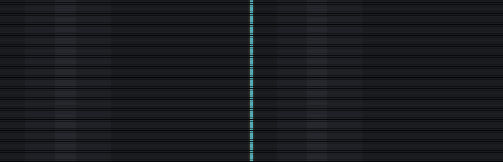

# dxo-one-xlab

<p align="center">
  
</p>

<!-- 启动动画配色取自 UI-设计规范 v1.2：#060709 / #F0EFE7 / #93928C / #2F2E28 / #4EADB9 -->

**DxO ONE 机内滤镜补丁** —— 在相机菜单里直接切换十档胶片风格，不用后期。

> `xlab` 是围绕 DxO ONE 做实验的地方：补丁、客户端、工具链与逆向记录都在这里迭代。
> 实验性质意味着结论会修正、版本会撤换，请以当前 README 与校验清单为准。

当前发布：**Build 60**（2026-11-12） · 适用固件 **3.2.0 (`ecef5ef809`)** · iOS / Lightning 机型

> Build 61（自定义 8×16 大字体）经实机验证字号过大、辨识度差，**已撤回**。
> 当前发布的 60 是保留原厂小字符的版本。

> 本仓库包含**相机端补丁 + 运行时依赖 + 说明**。桌面 / 移动端客户端仍在开发，暂未发布。

---

## ⚠️ 先读这里

| 项目 | 说明 |
|---|---|
| **授权** | 补丁程序与二进制 **All Rights Reserved**；允许个人在自己的设备上非商业使用，禁止再分发 / 商用 / 公开衍生版本。文档为 CC BY-NC 4.0。见 [LICENSE](LICENSE)。 |
| **第三方依赖** | `deps/` 下的 5 个文件**不是本仓库原创**，来自林达 (@PENTAX_FA43mm) 的 v26 触屏补丁与 Eli 的 iOS 移植版，未见明确许可证。**部署前必读 [DEPENDENCIES.md](DEPENDENCIES.md)**。 |
| **不是完整固件** | 不含 DxO 原厂固件、官方安装包、ROMFS 提取内容或任何原厂镜像；补丁只在开机时载入运行内存，不刷固件。 |
| **适用机型** | 仅 **iOS / Lightning 固件 `3.2.0 (ecef5ef809)`**；USB-C 原生版（`267b1a9e02`）请用林达原版 v26，不要用本套。 |
| **验证状态** | Build 60 为当前发布版本，维护者实机部署并选作回退基线，但逐项核对记录未随本仓库发布。请自行在设备上验证后再日常使用。 |
| **风险** | 写卡可能导致照片丢失、卡损坏或保修失效。先备份、逐文件校验、正常弹出卷后再拔卡。 |

本项目与 DxO Labs 无任何关联，未获其授权或认可。

---

## 这一版做了什么

- 相机菜单新增第六页，**十档滤镜循环**（上下切滤镜、左右翻页）
- **滤镜名称居中、小字精简**，沿用原厂小字符（Build 60）
- 切换滤镜后预览立即刷新（Build 58）
- 滤镜资产统一放 `DXO_FILTERS/`，只登记 `.bin`、不自动扫描 `.cube`（Build 57）
- 保留原厂曝光与拨盘分派；横滑预览不改拍摄设置；半按直接预览；关机无残字

## 十档滤镜

| # | 菜单名 | 文件 | 说明 |
|---:|---|---|---|
| 0 | ORIGINAL | `lut_orig.bin` | 透传档，保留源影调 |
| 1 | VELVIA | `lut_vel.bin` | |
| 2 | GOLD200 | `lut_gold.bin` | |
| 3 | PORTRA | `lut_port.bin` | |
| 4 | HP5 | `lut_hp5.bin` | 源素材为黑白风格 |
| 5 | RICOH POSI | `lut_posi.bin` | |
| 6 | RICOH HIBW | `lut_hibw.bin` | 源素材为黑白风格 |
| 7 | FUYUNO | `lut_fuyu.bin` | 冬野 |
| 8 | KYUSHU | `lut_kyus.bin` | 九秋 |
| 9 | SATOBI | `lut_sato.bin` | |

除 ORIGINAL 外，九档均按「源 LUT 原样直出 / 100% 强度 / 不叠加机内影调补偿」
处理；源素材本身是黑白的由源 LUT 自己决定，补丁不额外去色。

> 上述 CC 表的输入线性 / 输出 sRGB 匹配未做仪器校准，不宣称与原机或胶片
> 实物一致。9 个第三方派生表的权利状况见 [THIRD_PARTY.md](THIRD_PARTY.md)。

## 部署

**前提**

1. DxO ONE，iOS / Lightning 固件 `3.2.0 (ecef5ef809)`；
2. 已完整备份卡上 `autoexec.ash`、`touch_prefs.bin`、`dxot/` 与 `DCIM/`；
3. 已读完 [DEPENDENCIES.md](DEPENDENCIES.md) —— 特别是 `touch_prefs.bin` 绝不能盲目覆盖。

**第一步：运行时依赖（只需装一次）**

```bash
cd deps && shasum -a 256 -c SHA256SUMS.txt
```

把 `deps/dxot/` **整个目录**复制到卡根目录；`touch_prefs.bin` 按
[DEPENDENCIES.md](DEPENDENCIES.md) 的规则处理（卡上已有就保留）。

**第二步：滤镜补丁（Build 60）**

```bash
cd patch && shasum -a 256 -c SHA256SUMS.txt
```

把 `patch/autoexec.ash`、`patch/ph_probe.ash`、`patch/ph_menu.bin` 复制到**卡根目录**；
把 `patch/DXO_FILTERS/` 整个目录（10 个 `.bin`）复制到**卡根目录**。

3. 逐文件回读 SHA-256，与各自的 `SHA256SUMS.txt` 比对；
4. 正常弹出卷后拔卡，装回相机开机，**等约 3 秒**再触屏。

> ⚠️ 不要覆盖或删除 `DCIM/`、`touch_prefs.bin`、`dxot/`；
> 不要混用不同 Build 的 `ph_*` 信标；回退请恢复对应版本的整套文件。

## 版本与验证状态

| Build | 主要变化 | 状态 |
|---|---|---|
| 57 | 滤镜资产目录化、十档循环 | 维护者实机确认通过 |
| 58 | 切滤镜后预览立即刷新 | 已写卡部署；该项实机确认记录未随本仓库发布 |
| **60** | **名称居中、小字精简（原厂小字符）** | **当前发布版本**；菜单包 `ph_menu.bin` 4424 B，magic `0x5047353a`。实机部署并选作回退基线，逐项核对记录未随附 |
| ~~61~~ | ~~自定义 8×16 大字体~~ | **已撤回**：实机字号过大、辨识度差 |

Build 60 与已撤回的 61 只有 `ph_menu.bin` 一件不同（4424 B vs 5608 B），
其余 12 件（`autoexec.ash`、`ph_probe.ash`、10 个 LUT 包）逐字节一致。
若你手上是 61，只需换回本仓库的 `patch/ph_menu.bin` 即可，其余文件不必重装。

## 仓库文件

| 路径 | 内容 |
|---|---|
| `patch/` | Build 60 的 13 件构建产物 + `SHA256SUMS.txt` |
| `deps/` | 5 个第三方运行时依赖 + `SHA256SUMS.txt`（**非本仓库原创**） |
| `DEPENDENCIES.md` | 依赖来源、署名、适用固件与部署规则 |
| `THIRD_PARTY.md` | 第三方材料与商标声明 |
| `CONTRIBUTING.md` | 反馈方式与提交红线 |

## 风险与免责

写入相机存储卡可能导致照片丢失、卡损坏、固件异常或保修失效。请自行备份、
逐文件校验、正常弹出卷后再拔卡。作者不对任何直接或间接损失负责，
完整条款见 [LICENSE](LICENSE)。

## 路线

- 桌面 / 移动端客户端：开发中，完成后单独发布
- 逆向分析文档与构建工具链：后续视情况整理公开

---

_Build 60 · 2026-11-12 · 客户端未包含在本仓库_
